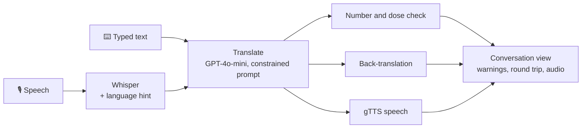

# Medical Interpreter: Speech Translation for Clinician-Patient Conversations

[](https://github.com/shelenderrkumar/Healthcare-Translation-App-with-Gen-AI/actions/workflows/ci.yml)


A two-way, spoken interpreter for a clinician and a patient who don't share a language.
Each side speaks (or types) in their own language. The app transcribes the speech, translates
it, **checks the translation for dangerous errors**, and reads it aloud to the other person.
It supports 10 languages, including **Urdu**, Hindi, Arabic and Spanish.

**Stack:** OpenAI Whisper (speech-to-text), GPT-4o-mini (translation), gTTS (speech), Streamlit.

> ⚠️ This is an assistive research prototype, not a certified medical interpreter.

## The problem

Language barriers in healthcare lead to misdiagnosis, medication errors and lower patient
satisfaction, and professional interpreters are not always available. Large language models
translate fluently, but fluency hides errors. A translation can read perfectly while
**dropping a dose, changing a number or losing a "not"**. This project explores practical
safeguards that make those errors visible to the clinician.

## Safety checks

| Check | What it catches | How |
|---|---|---|
| **Number and dose preservation** | "Take 500 mg" → "Tome mg"; "2019" → "2009" | Every number in the source must appear in the translation, compared as multisets so word order can change. Native digits are normalised first (Urdu `۵۰۰`, Hindi `५००`, Arabic `٥٠٠`), as are decimal commas and thousands separators. Mismatches show as warnings. Deterministic, with no extra model call. |
| **Round-trip (back) translation** | Changed meaning, lost negation, wrong body part | The translation is translated back into the clinician's language, so they can read what the patient will actually hear. Back-translation is a standard quality-assurance technique in medical translation. |
| **Constrained translation prompt** | Added advice, simplified meaning, prompt injection | The model is told to keep negations, uncertainty, units, numbers and drug names exactly, add nothing, and treat the speech only as text to translate, even if it contains instructions. Temperature is 0. |
| **Language hint for Whisper** | Short clips transcribed in the wrong language or script | The selected language is passed to Whisper instead of relying on auto-detection. |

## Features

- **Conversation mode:** separate panels for clinician and patient, with a shared transcript
  showing each translation, the original, the round-trip check and the audio.
- **Voice or text input** on either side.
- **No double billing:** each recording is fingerprinted (SHA-256) and processed once, even
  though Streamlit re-runs the script on every click.
- **Graceful degradation:** a text-to-speech failure never loses the text translation.
- **Privacy notice:** the UI states that data goes to OpenAI, and nothing is stored on disk.

## Quick start

```bash
git clone https://github.com/shelenderrkumar/Healthcare-Translation-App-with-Gen-AI.git
cd Healthcare-Translation-App-with-Gen-AI
python -m venv .venv && source .venv/bin/activate
pip install -e ".[dev]"
cp .streamlit/secrets.toml.example .streamlit/secrets.toml   # add your OpenAI key
streamlit run app.py
```

The repo also deploys to Streamlit Community Cloud (`requirements.txt`) and opens in
GitHub Codespaces (`.devcontainer/`).

## Architecture



```
medtranslate/
  pipeline.py    transcribe -> translate -> verify -> speak (OpenAI client injected)
  safety.py      digit normalisation and number/dose preservation check
  languages.py   supported languages with Whisper and TTS codes
  prompts.py     interpreter prompt
app.py           Streamlit conversation UI
tests/           unit tests and headless UI tests (Streamlit AppTest)
```

## Testing

```bash
pytest -q      # 19 tests, no API key or network needed
ruff check .
```

The tests cover:
- the safety checks: native-digit normalisation, a dropped dose, a changed year, repeated
  numbers, and Urdu translations written with Urdu digits
- the pipeline against a fake OpenAI client: the language hint, the prompt's injection guard,
  the round-trip check, and text-to-speech failures
- the actual Streamlit app, run headlessly with Streamlit's `AppTest`

## Limitations and future work

- **Evaluation:** the next step is a test set of clinical phrases (e.g. from
  medication-instruction corpora) translated into each language, comparing number-check
  recall and back-translation agreement against professional reference translations.
- Numbers written as words ("five") are not yet matched to digits, so they can produce false
  warnings.
- The round-trip check relies on a human reading it. An automatic semantic comparison
  (e.g. an LLM judge or a cross-lingual embedding similarity) could flag drift directly.
- gTTS voices are basic. A neural text-to-speech model would sound more natural.

## License

[MIT](LICENSE)
